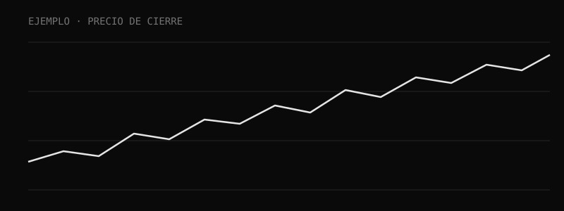

Esta publicación sirve para ver cómo quedan los distintos elementos. Como tiene `borrador: true`, **solo se ve cuando probás la web en tu computadora**. Podés borrarla o usarla de punto de partida.

## Títulos y texto

El texto común se lee con un ancho cómodo. Se puede usar **negrita**, *cursiva*, `código en línea` y [enlaces](https://espacio-digital.vercel.app/finance).

### Un subtítulo más chico

> Las citas sirven para destacar una idea o una frase de otra persona.

1. Listas numeradas
2. para pasos en orden

- Y listas con viñetas
- para enumerar cosas

## Tabla

| Activo   | Precio  | Var. 1D | Volatilidad anual |
|----------|--------:|--------:|------------------:|
| SPY      |  716,70 | −0,29 % |           15,2 %  |
| GGAL.BA  | 4910,00 | +3,26 % |           48,7 %  |
| YPFD.BA  | 5945,00 | +5,78 % |           41,3 %  |

*Valores ilustrativos.*

## Código

```python
import pandas as pd

def rendimiento(precios: pd.Series, dias: int) -> float:
    """Rendimiento porcentual de los últimos `dias` días."""
    return (precios.iloc[-1] / precios.iloc[-dias - 1] - 1) * 100
```

## Imagen

Las imágenes van en la misma carpeta que el archivo `.md` y se enlazan con `./nombre.png`:


